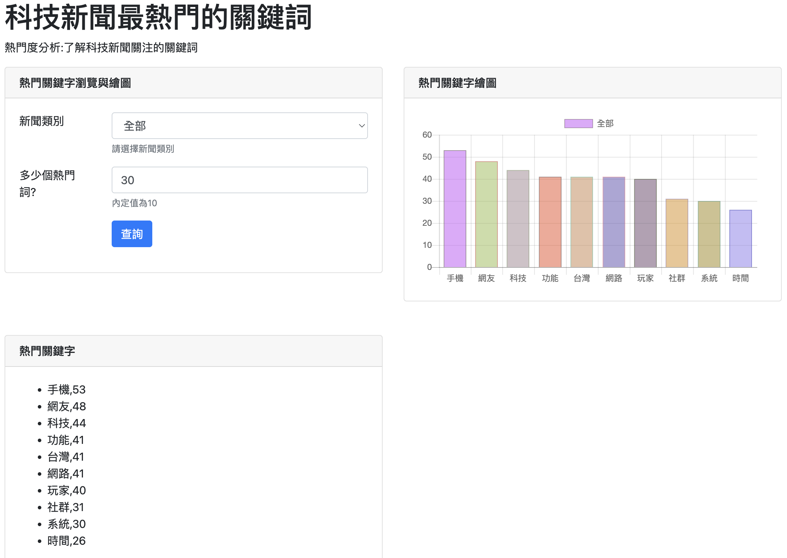
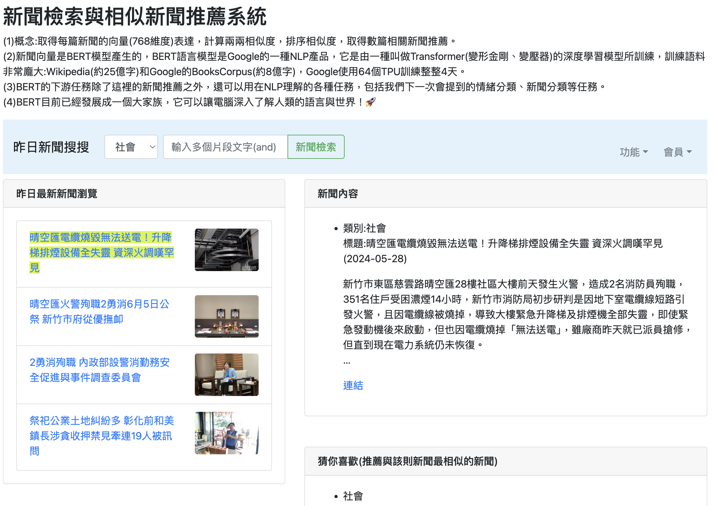
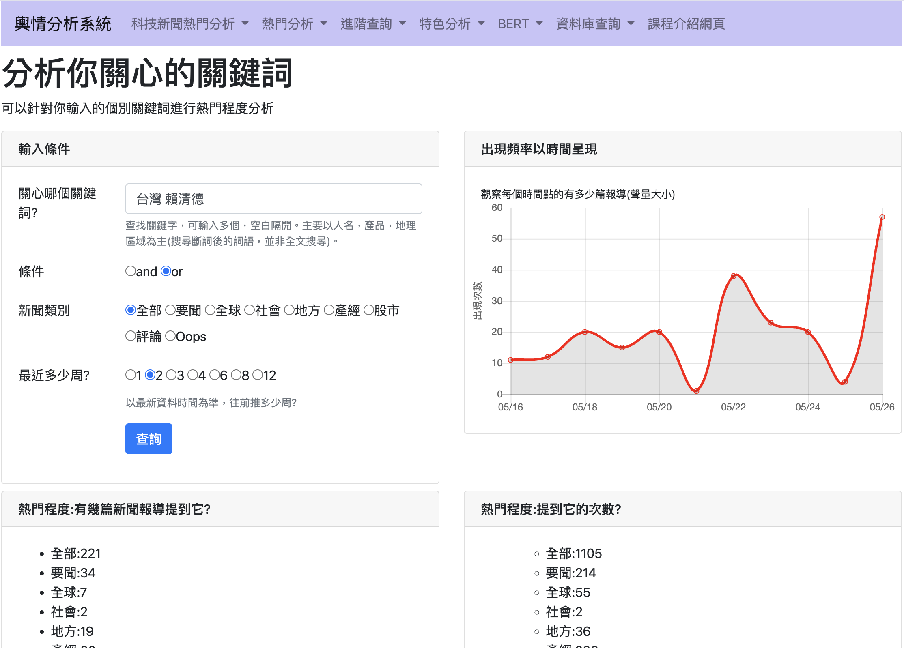
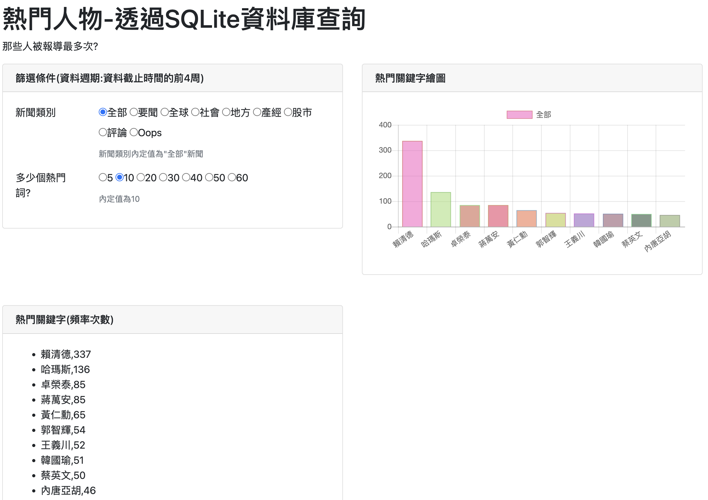

# 新聞大數據分析系統
## 專案介紹
本專案使用 Python 與 Django 開發新聞大數據分析網站，透過網路爬蟲蒐集新聞資料，並進行資料整理、關鍵字統計與分析，將分析結果以圖表及互動式網頁呈現。
系統整合新聞熱度分析、關鍵字查詢、新聞趨勢觀察及相似新聞推薦等功能，讓使用者能依照不同的新聞類別、關鍵字及時間範圍進行查詢，進一步了解特定議題在新聞中的出現頻率與變化趨勢。

## 使用技術

| 技術 | 應用說明 |
|---|---|
| Python | 網路爬蟲、新聞資料處理及關鍵字統計分析 |
| Django | 網站功能開發、查詢處理及前後端整合 |
| HTML、CSS | 網頁介面與版面呈現 |
| BERT | 新聞語意向量與相似新聞推薦功能 |
| 資料視覺化 | 將新聞統計及趨勢分析結果以圖表呈現 |

## 主要功能

### 1. 新聞資料蒐集

透過 Python 網路爬蟲蒐集新聞網站的相關資料，並將取得的新聞內容進行整理，作為後續資料分析與查詢的基礎。

### 2. 關鍵字熱度分析

提供使用者自行輸入感興趣的關鍵字，並設定不同的查詢條件，分析關鍵字在新聞中的出現情形。

**功能包含：**
- 支援單一或多個關鍵字查詢。
- 提供 AND、OR 搜尋條件。
- 可依新聞類別進行篩選。
- 可選擇不同週數的分析範圍。
- 統計相關新聞篇數與關鍵字出現次數。
- 以時間趨勢圖呈現關鍵字熱度變化。

### 3. 新聞熱門趨勢分析

透過新聞資料的統計結果，觀察特定關鍵字及新聞議題的熱度變化，協助使用者了解不同時間區間的新聞討論情形。

### 4. 進階新聞查詢

提供新聞資料的條件篩選與查詢介面，讓使用者透過網頁瀏覽符合查詢條件的新聞資訊。

### 5. BERT 相似新聞推薦

系統提供基於 BERT 新聞向量的相似新聞推薦介面，透過比較新聞內容的語意相似程度，呈現與指定新聞相關的其他報導。

**功能包含：**
- 依新聞類別搜尋新聞。
- 顯示新聞標題、內容及相關資訊。
- 呈現相似新聞推薦結果。
- 顯示新聞之間的相似度數值。
- 提供新聞原始連結供使用者查看。

### 6. 新聞資料庫查詢

提供新聞資料查詢與瀏覽功能，方便使用者查看系統中已蒐集的新聞資訊。

---

## 系統畫面展示

### 1. 關鍵字熱度分析

使用者可自行選擇新聞類別、搜尋條件及時間範圍，查看關鍵字在新聞中的出現次數與熱度變化。
系統透過趨勢圖及統計數據，呈現不同時間點的關鍵字提及情形。

### 2. BERT 新聞搜尋與相似新聞推薦

使用者可透過新聞搜尋功能查看相關新聞內容，並瀏覽系統提供的相似新聞推薦結果。
畫面會呈現新聞標題、文章內容、相關新聞及相似度數值，協助使用者探索語意相關的報導。

### 3. 進階新聞查詢

依照不同條件篩選新聞資料，提供使用者瀏覽與查詢相關新聞的操作介面。

### 4. 其他分析功能

系統亦包含其他新聞分析功能，可從不同角度觀察新聞資料及相關資訊。

---

## 專案分析流程

1. **新聞資料蒐集：** 使用 Python 網路爬蟲取得新聞資料。
2. **資料整理：** 整理蒐集到的新聞內容，作為後續分析的資料來源。
3. **資料統計與分析：** 依照關鍵字、新聞類別及時間範圍進行統計分析。
4. **網站功能整合：** 使用 Django 建立新聞查詢與分析功能。
5. **結果視覺化：** 透過統計數據及圖表呈現新聞分析結果。
6. **互動式查詢：** 提供使用者自行設定條件並查看分析結果。

## 專案成果

完成以 Django 為核心的新聞資料分析網站，整合 Python 網路爬蟲、關鍵字分析、新聞資料查詢及視覺化呈現等功能。
系統透過互動式查詢介面，讓使用者能根據不同的新聞類別、關鍵字及時間範圍查看分析結果，並透過趨勢圖觀察新聞議題的熱度變化。
本專案累積了 Python 資料處理、Django 網站開發、新聞文字分析及前後端整合的實作經驗。

---

## 專案說明

本專案為新聞資料分析與網站應用的學習實作作品，主要展示新聞資料蒐集、統計分析及網站功能整合。
相關新聞內容與分析結果依專案使用的資料來源及資料時間範圍而定。

## 專案下載

完整專案檔案請至 [GitHub Releases](https://github.com/yenchen0605/news-analysis-django/releases/download/v1.0.0/news_analysis_django.zip) 下載。
